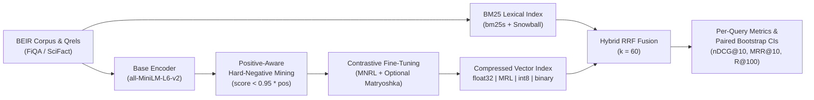

# Embedding Fine-Tuning & Compressed Retrieval (`embedtune`)

Domain-adapted dense retrieval on **BEIR FiQA** (financial QA) with **positive-aware hard-negative mining**, **Matryoshka Representation Learning (MRL)**, **int8 / binary vector compression**, and **BM25 + dense Reciprocal Rank Fusion (RRF)** — benchmarked against BM25 and the untuned base encoder, with out-of-domain transfer tracked on **BEIR SciFact**.

## Problem Statement

General-purpose small embedding models (such as `sentence-transformers/all-MiniLM-L6-v2`, 22M parameters, 384d) underperform on specialized domains like financial QA where terminology and relevance criteria diverge from web-scale training corpora. At the same time, production retrieval systems face three simultaneous constraints:

1. **Retrieval quality**: Improving domain nDCG@10 and Recall@100 without catastrophic forgetting on out-of-domain corpora.
2. **False-negative noise in mining**: Naive top-k hard-negative mining over incomplete BEIR qrels often pulls unlabelled true positives as negatives.
3. **Index memory footprint**: Full `float32` 384-dim embeddings cost 1,536 bytes/doc; production indexes need graceful quality/memory trade-offs via Matryoshka truncation, scalar `int8`, or 1-bit binary quantization with float rescoring.

## Architecture



## Key Capabilities

- **BEIR Data Loader (`embedtune.data`)**: Downloads and normalizes `BeIR/<name>` parquet tables and qrels splits from Hugging Face Hub, retaining graded positive judgements.
- **Positive-Aware Hard-Negative Mining (`embedtune.mining`)**: Implements NV-Retriever-style filtering (`score < max_ratio * pos_score`) to exclude likely unlabelled positives from the top-k candidate pool, with deterministic positive sampling across variants.
- **Contrastive & Matryoshka Training (`embedtune.train`)**: `MultipleNegativesRankingLoss` with `NO_DUPLICATES` batch sampling and optional `MatryoshkaLoss` over `(384, 192, 96, 48)` dimensions.
- **Exact & Compressed Retrieval (`embedtune.retrieval`)**:
  - `BM25`: `bm25s` with English stopwords and Snowball stemming (handles all-stopword edge-case queries safely).
  - `topk`: Chunked exact cosine/inner-product search.
  - `truncate`: Matryoshka prefix slicing + L2 renormalization.
  - `Int8Codec`: Per-dimension calibrated scalar quantization with asymmetric float-query search.
  - `binary_encode` / `binary_search`: Bit-packed sign quantization (8 dims/byte) with Hamming candidate retrieval and float-query sign rescoring.
  - `rrf`: Reciprocal Rank Fusion (`1 / (60 + rank)`).
- **Statistical Evaluation (`embedtune.metrics`, `embedtune.evaluate`)**: Linear-gain `nDCG@10` (matching `pytrec_eval`/BEIR/MTEB), `MRR@10`, `Recall@100`, and 2,000-sample paired bootstrap 95% confidence intervals.

## Benchmark Results

### Observed Lexical Baselines (from `eval.log`)

Measured via `python -m embedtune.evaluate` against the full BEIR corpora (depth = 100):

| System | Dataset / Split | nDCG@10 | Recall@100 |
| :--- | :--- | :---: | :---: |
| `bm25` (`bm25s` + Snowball) | `fiqa/dev` | **0.2592** | **0.5495** |
| `bm25` (`bm25s` + Snowball) | `fiqa/test` | **0.2514** | **0.5593** |
| `bm25` (`bm25s` + Snowball) | `scifact/test` | **0.6863** | **0.9127** |

> **Note:** Full dense fine-tuning variants (`in_batch`, `hard_filtered`, `hard_top`, `hard_filtered_matryoshka`) and compression sweeps are pre-registered in `embedtune.evaluate.VARIANTS` and ready to run on CPU or GPU via `embedtune-eval --out results`. Only verified numbers from completed runs are reported above.

### Pre-Registered Training & Compression Matrix

| Variant | Negative Mining | Matryoshka Dims | Purpose |
| :--- | :--- | :--- | :--- |
| `in_batch` | None (in-batch only) | Full 384d | Contrastive baseline |
| `hard_top` | Ranks `[0, 10)` unfiltered | Full 384d | Tests false-negative sensitivity |
| `hard_filtered` | Ranks `[0, 50)`, `max_ratio=0.95` | Full 384d | Positive-aware hard negatives |
| `hard_filtered_matryoshka` | Ranks `[0, 50)`, `max_ratio=0.95` | `(384, 192, 96, 48)` | Multi-resolution truncation |

| Representation | Bytes / Doc | Compression vs `float32_384` |
| :--- | :---: | :---: |
| `float32_384` | 1,536 B | 1x |
| `float32_192` | 768 B | 2x |
| `float32_96` | 384 B | 4x |
| `int8_384` | 384 B | 4x |
| `float32_48` | 192 B | 8x |
| `binary_384` | 48 B | 32x |

## Quickstart

```bash
# Install package with dev dependencies
pip install -e ".[dev]"

# Run unit tests
pytest

# Run full BEIR FiQA + SciFact evaluation pipeline
embedtune-eval --out results --threads 4

# Run a single training variant
embedtune-eval --out results --variants hard_filtered_matryoshka
```

## Project Structure

```text
src/embedtune/
├── data.py       # BEIR dataset loader & split helpers
├── mining.py     # Positive-aware hard-negative mining
├── train.py      # MNRL & Matryoshka fine-tuning wrapper
├── retrieval.py  # BM25, dense top-k, int8/binary quantization, RRF
├── metrics.py    # nDCG@10, MRR@10, Recall@100, paired bootstrap CIs
└── evaluate.py   # End-to-end experiment runner & latency benchmark
tests/
├── test_core.py  # Retrieval, compression, mining, and metric unit tests
└── test_train.py # Offline tiny-BERT contrastive training smoke test
```

## License

MIT — see [LICENSE](LICENSE).
